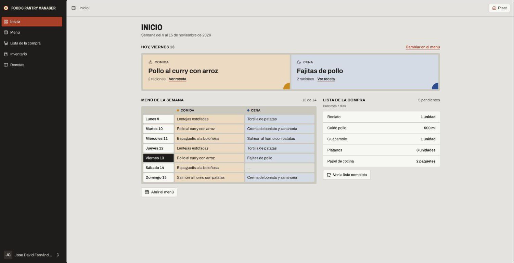
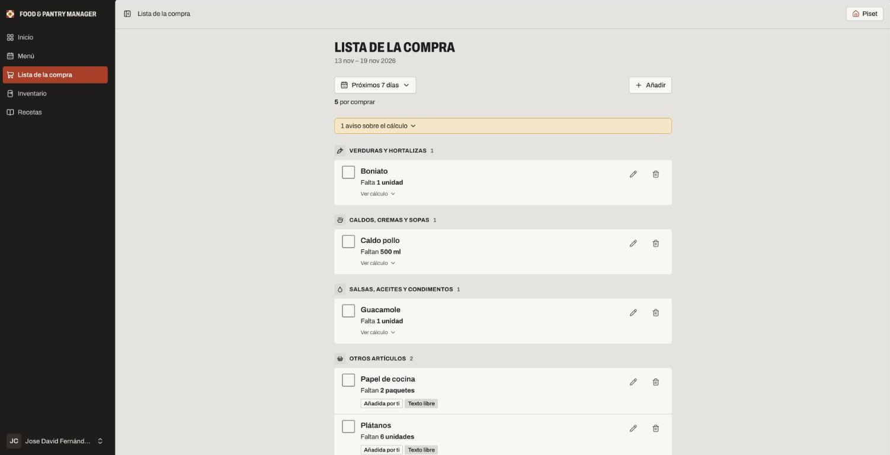
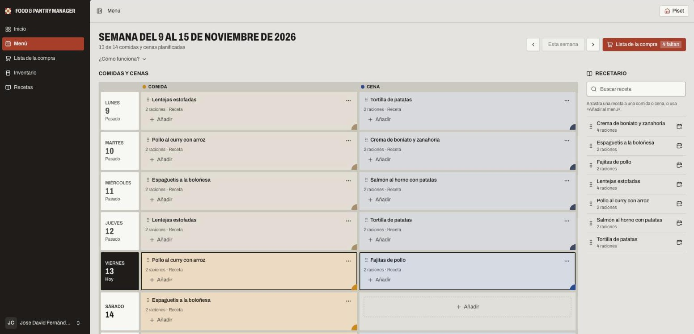
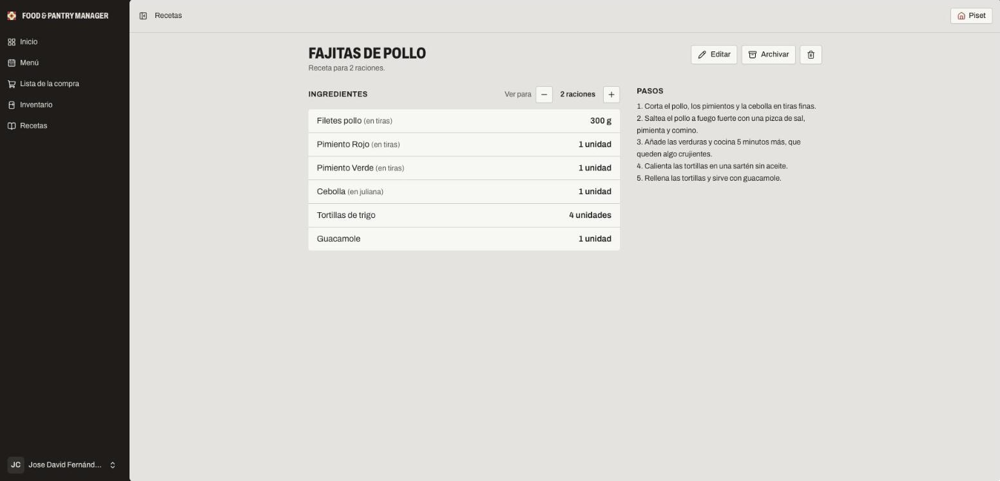
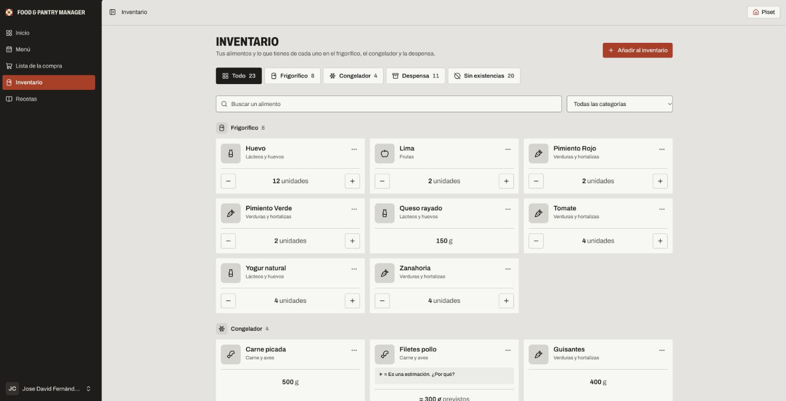
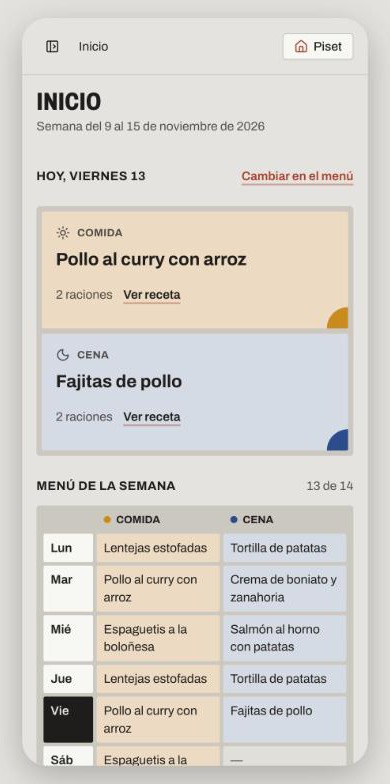
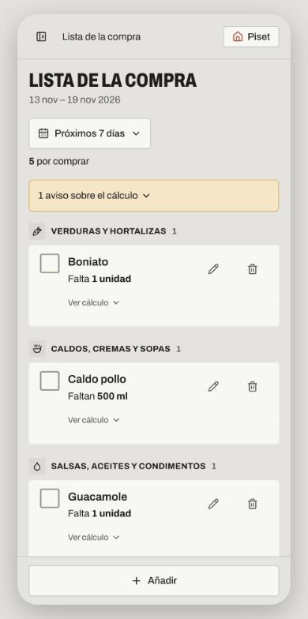
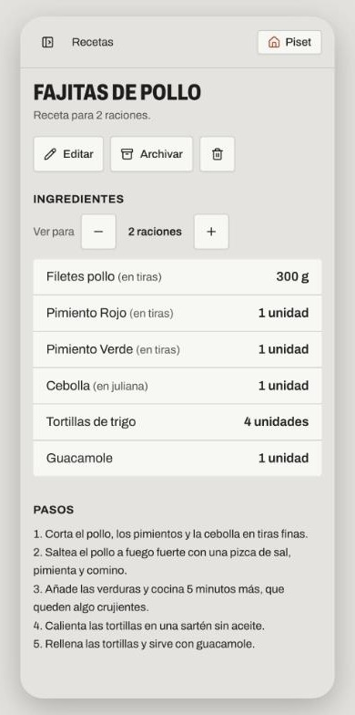

# Food & Pantry Manager

Aplicación web para gestionar la despensa, las recetas, el menú semanal y la lista de la compra de un hogar. Pensada para usarse de verdad en el día a día: planificas las comidas de la semana y la aplicación calcula, comparando con lo que ya tienes en casa, **qué te falta comprar** y en qué cantidad.

Proyecto personal, desarrollado de principio a fin (análisis, diseño, backend, frontend, pruebas y despliegue) como ejercicio de construir un producto completo y cuidado, no una demo.

🔗 **En producción:** https://foodpantry.josedavidfernandezcomino.com

> El registro crea una cuenta real y pide verificar el correo. La interfaz está en español.

## Capturas

### Escritorio

| Inicio | Lista de la compra |
|---|---|
|  |  |

| Menú semanal | Receta |
|---|---|
|  |  |

### Móvil

  
  
  

---

## Qué hace

- **Multiusuario por hogar.** Cada hogar tiene sus datos aislados. Se invita a otras personas por correo y hay tres roles: administrador, editor y lector. Los permisos se comprueban en el servidor, no solo en la interfaz.
- **Inventario.** Catálogo de alimentos con alias (p. ej. «patatas» → «patata»), categorías e imágenes. Las existencias se organizan por ubicación (frigorífico, congelador y despensa), con unidades y equivalencias (1 bolsa = 500 g).
- **Recetas.** Escalado automático por raciones, archivado, ingredientes alternativos («arroz o pasta») y preparaciones reutilizables como ingrediente de otras recetas.
- **Menú semanal.** Planificación continua de comida y cena, con varios platos por comida y organización mediante arrastrar y soltar (con alternativa accesible por teclado).
- **Lista de la compra por periodo.** Calcula las necesidades del menú frente al inventario, redondea lo que no se puede partir, agrupa la compra por envases y permite registrar la compra recibida, que actualiza el inventario.
- **Existencias previstas.** Estima lo que queda en casa a partir de lo planificado, sin obligar a recontar a mano.
- **Imágenes de alimentos** desde Wikimedia Commons y Open Food Facts, con atribución y sin claves de API.

## Cómo está construido

| Capa | Tecnología |
|---|---|
| Backend | Laravel 13 · PHP 8.3 |
| Frontend | Vue 3 + TypeScript · Inertia 3 (SPA sin API separada) |
| Estilos | Tailwind CSS 4 · componentes sobre Reka UI (shadcn-vue) |
| Base de datos | MySQL / MariaDB |
| Autenticación | Laravel Fortify · verificación por correo · 2FA · llaves de acceso (passkeys) |
| Pruebas | Pest 4 (pruebas de funcionalidad y unitarias) · Playwright (extremo a extremo) |

## Decisiones de ingeniería

- **Lógica de negocio en acciones de dominio**, fuera de los controladores y de los componentes Vue, para que las reglas vivan en un solo sitio y se puedan probar.
- **Multi-tenant por hogar** con *policies* y *scopes*: un usuario nunca ve ni modifica datos de otro hogar.
- **Cantidades con `bcmath`**, nunca con números en coma flotante, para evitar errores de redondeo al sumar y restar existencias.
- **Más de 450 pruebas automáticas** (Pest) y un recorrido completo **de extremo a extremo** (Playwright), además de análisis estático (Larastan/PHPStan y `vue-tsc`).
- **Accesibilidad y móvil primero** en las pantallas de uso diario: objetivos táctiles de 44 px, foco visible y alternativas a las interacciones de arrastrar y soltar.

## Ejecutarlo en local
Crea dos bases MySQL (una de desarrollo y `food_pantry_manager_test` para Pest, que la fija `phpunit.xml`), copia `.env.example` a `.env` con las credenciales de la base de desarrollo y ejecuta `composer setup` (instala dependencias, genera la clave, migra y compila los assets). Después copia `.env` a `.env.testing` y cambia en él las credenciales por las de la base de pruebas.

## Estado

MVP funcional y desplegado. Documentación de producto y técnica (reglas de negocio, modelo de datos, roadmap y decisiones) en el repositorio.

## Autor

**Jose David Fernández Comino** — [LinkedIn](https://www.linkedin.com/in/josedavidfernandezcomino/) · [GitHub](https://github.com/JoseDavidFernandez)
